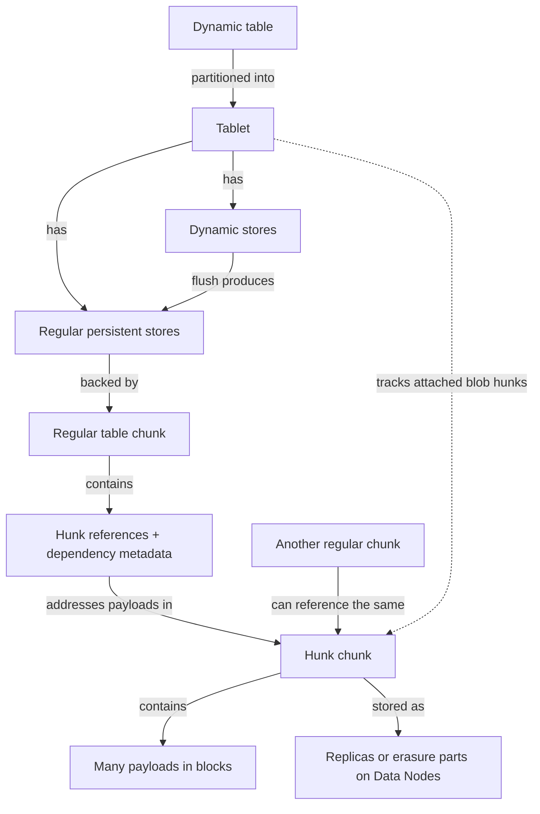
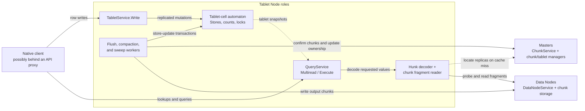

# Hunk chunks in dynamic tables

Large values can dominate the cost of a dynamic table. A row may contain a small key, a few frequently accessed attributes, and a much larger document or serialized object. Storing all of these together means that the large payload participates in storage operations even when the application mainly needs the smaller fields.

Hunk chunks let YTsaurus separate large values from the regular table chunks that describe rows. A regular chunk retains the keys, timestamps, small values, and references to larger values. The referenced payloads live in hunk chunks and are fetched when needed. Applications continue to read and write ordinary values through the table API.



Implementation details in this draft refer to the upstream source snapshot
[aa10d95230d96](https://github.com/ytsaurus/ytsaurus/commit/aa10d95230d96c072a6961357ece9aff645aa0df)
dated 16 October 2026. Examples are illustrative and have not been executed against a cluster.



## Architecture overview { #architecture }

Hunk storage separates three responsibilities. The tablet's row stores determine
which row versions a read can see. A hunk reference identifies the bytes of a
value. Reference accounting and chunk ownership determine how long those bytes
must remain available. Reading a value and deciding whether its storage can be
released therefore use different state.

The main architecture below describes **blob hunks in sorted dynamic tables**:
large values become external during flush or compaction. The optional
[external hunk-storage path](#external-hunk-storage) writes journal hunks earlier
and adds a separate storage object, hunk tablets, and a lock protocol.

### Concepts and objects { #objects }

The term *hunk* means one external value payload. A *hunk chunk* is a storage
container holding many hunks. Neither is a row: a row can have several large
columns, and a hunk chunk can contain values from many rows.

<small>Table 1 — Objects in the blob-hunk architecture</small>

| Object | Meaning | Main relationships |
| --- | --- | --- |
| Dynamic table | Logical dataset with a schema and storage settings | Contains tablets; its column schema selects values eligible for external storage |
| Tablet | A partition of the table; a key range for a sorted table | Has row stores and tracks the blob hunk chunks attached to it |
| Dynamic store | Mutable in-memory row data, later frozen for flushing | Accepts row versions; flush produces persistent stores |
| Regular persistent store | A tablet's view of persisted row data | Refers to a regular table chunk and resolves that chunk's hunk dependencies |
| Regular table chunk | Immutable storage of row keys, timestamps, small values, and hunk references | Contains the metadata mapping its local hunk indexes to chunk IDs |
| Hunk reference | Encoded address replacing an external value in a cell | Identifies a payload within a hunk chunk; a local reference needs its regular chunk's metadata |
| Hunk chunk | A chunk containing payloads grouped into blocks | Can be referenced by several regular chunks; has a master chunk object and physical replicas or erasure parts |
| Hunk payload | Bytes of one externalized value, with a checksum header | Occupies a fragment of a hunk chunk; has no separate master object |
| Replica or erasure part | Physical chunk data stored on a Data Node | Can change location without changing the chunk ID in payload references |

The arrows below are labeled because containment, dependency, and physical
placement have different lifetime rules.



A regular store and its underlying chunk are distinct objects: the store belongs
to a tablet's current row-storage view, while the immutable chunk can outlive that
view. Similarly, the tablet's `THunkChunk` is an accounting object for a chunk ID;
it does not hold the payload bytes. The corresponding master chunk object tracks
ownership and replicas, and Data Nodes hold the actual data.

There is no one-to-one relationship between regular chunks and hunk chunks.
Compaction can create a new regular chunk that reuses payloads from several old
hunk chunks. It can also copy selected surviving payloads into new hunk chunks.
The resulting dependency graph is the basis of reference accounting and cleanup.
[Hunk formats and interfaces][hunk-value-format],
[store-to-hunk links][store-hunk-links], [master chunk ownership][master-hunk-refs].

### Processes, cells, and RPC services { #services }

A **Tablet Node** is a process that hosts tablet-cell peers and runs tablet work.
A **tablet cell** is a replicated state machine hosting a group of tablets. Its
automaton applies changes to row stores, hunk accounting, and transaction locks;
its state survives a leader change or process restart. Request handlers and
background workers run in the hosting process and submit changes to that
automaton. A worker's task queue or a reader's cache is not replicated tablet
state.

Masters maintain the table and chunk ownership graph. Data Nodes store chunk
replicas and serve their bytes. These roles can be co-located in a deployment, but
their responsibilities remain separate. For the ordinary blob-hunk path, no
additional hunk-specific server is needed.



The service boundaries give concrete names to these interactions:

- `TabletService.Write` accepts table writes for a tablet cell. The same service
  exposes `WriteHunks` for the optional journal-hunk path.
- `QueryService.Multiread` serves tablet lookups; `Execute` runs query work. Their
  readers decode requested hunk values before returning application results.
- The master's `ChunkService` exposes operations such as `CreateChunk`,
  `ConfirmChunk`, and `LocateChunks`. Confirmation registers dependencies;
  location lookup discovers replicas. Cached locations can avoid the latter
  request. Publishing stores additionally uses coordinated transaction actions
  in the master and tablet cell.
- `DataNodeService.ProbeChunkSet` checks candidate replicas, and
  `GetChunkFragmentSet` returns requested byte fragments. The fragment reader
  batches these requests and handles replica selection and retries.

[Tablet service][tablet-rpc-service], [query service][query-rpc-service],
[master chunk service][master-chunk-service], [Data Node service][data-node-fragments].

### Active subsystems { #subsystems }

Chunks and references are passive data objects. The subsystems in Table 2 create,
read, replace, and release them. Workers that change the tablet's dependency graph
publish those changes through store-update transactions.

<small>Table 2 — Active subsystems in the blob-hunk lifecycle</small>

| Subsystem and host | Trigger | Work and state used |
| --- | --- | --- |
| Store flusher on a Tablet Node | A frozen dynamic store needs persistence | Writes regular and hunk chunks, builds dependency metadata, and publishes persistent stores |
| LSM compaction planner and Tablet Node compaction worker | Compaction policy or a forced revision selects work | Plans from store and hunk metadata; merges row versions; preserves references or rewrites selected payloads |
| Tablet manager in the tablet-cell automaton | Store-update transaction prepare, commit, or abort | Validates dependencies and locks; changes the store graph and the tablet's hunk counters |
| Hunk-chunk sweeper on the tablet-cell leader | A mounted tablet has dangling hunk chunks | Uses the maintained dangling set and transient scheduling state; submits transactions to detach unused hunks |
| Master chunk and tablet managers | Chunk confirmation, store updates, and chunk destruction | Maintain chunk-list ownership and regular-chunk-to-hunk object references; govern the ownership needed for storage reclamation |
| Master chunk replicator and Data Node job controller | Replica-management decisions and removal jobs | Schedule and execute physical replica removal; track replica and job state separately from tablet reference counters |
| Hunk decoder and fragment reader in the tablet read path | A read needs external values | Resolve references, discover or reuse replica locations, batch fragment RPCs, and validate and decode payloads |
| Data Node chunk storage and service | Chunk writes, fragment reads, and replica-management work | Store and serve bytes using local readers, caches, and I/O guards |

The sweeper does not perform row-version retention or copy surviving payloads.
Compaction does that work and publishes the remaining references. The sweeper
acts later, when the tablet can release a whole hunk chunk. Master ownership can
retain that chunk beyond the lifetime of this tablet's references.
[Flush worker][hunk-flusher], [compaction worker][hunk-compactor],
[compaction planning][hunk-compaction-selection], [tablet updates][tablet-store-updates],
[sweeper][hunk-sweeper], [replica removal scheduling][chunk-replicator],
[Data Node removal jobs][data-node-jobs].

### State ownership and recovery { #state-ownership }

Three persistent descriptions govern addresses and lifetime:

- **Chunk metadata records payload addresses.** The regular chunk stores encoded
  cell references and a dependency table. A writer builds this metadata with
  temporary maps; the finished metadata is immutable.
- **Tablet state determines whether a tablet can release a hunk chunk.**
  `TTablet` keeps its store graph, `HunkChunkMap_`, counters, prepared updates,
  locks, and current dictionary IDs. Each tablet's `THunkChunk` records that
  tablet's dependencies. These counts are local to the tablet.
- **Master state records remaining chunk ownership.** Chunk lists and object
  references from confirmed regular chunks can retain a hunk chunk even after a
  particular tablet has detached it. Physical replica removal follows the usual
  chunk-management process once remaining ownership disappears.

Tablet state changes run through the cell's replicated automaton. The hunk map
and each `THunkChunk`'s counters, metadata, committed state, and transaction locks
are saved in snapshots and restored on recovery. On mount, the store manager also
builds store-to-hunk links from the supplied chunk descriptors. Attached-dictionary
flags are restored from the saved current dictionary IDs. The
`DanglingHunkChunks_` set is maintained from these facts, allowing the sweeper to
visit candidates without rescanning rows.

Reader caches, per-writer index maps, and sweep scheduling state accelerate work
and can be rebuilt. They do not establish persistent ownership. A Data Node's
local read guards protect I/O in progress; they do not decide whether a row
version remains live. The [reference-accounting section](#live-references) explains
the counters, and the [cache section](#read-caches) identifies the reusable read
state.
[Tablet state and snapshots][tablet-hunk-accounting],
[saved hunk state][tablet-hunk-state], [mount initialization][tablet-store-mount],
[master dependency lifetime][master-hunk-refs].

## Design and tradeoffs { #design }

The central design choice is to give row structure and large payloads different
physical lifecycles. Regular chunks can be reorganized repeatedly while many hunk
payloads stay in place. References identify the bytes needed to reconstruct a
value without tying them to a particular replica location.

The main benefits come from reducing the amount of data that moves through expensive storage paths. In an in-memory table, hunk payloads are excluded from the regular chunks loaded into tablet static memory. This can make a table much cheaper to keep in memory, although a lookup that requests a referenced payload may require a storage read. Freshly written values can still occupy dynamic-store memory before flush, so static-memory savings should not be interpreted as an equivalent reduction in every category of tablet memory. [Memory accounting tests](https://github.com/ytsaurus/ytsaurus/blob/aa10d95230d96c072a6961357ece9aff645aa0df/yt/yt/tests/integration/dynamic_tables/test_dynamic_tables_hunks.py#L870)

Hunks also reduce compaction traffic. Without separation, rewriting a row’s storage representation can involve rewriting its entire large value. With hunks, compaction can carry the reference forward.

An illustrative cost model is:

```text
Without hunks:  C × (S + V)
With hunks:     C × (S + R) + H × V
```

Here, `S` is the small part of the data, `V` is the large payload data, `R` is the references, `C` is regular-chunk rewrite activity, and `H` is hunk rewrite activity. The mechanism is attractive when `V` is large and `H` is substantially lower than `C`. This model omits compression, logs, replication, and metadata overhead, but explains why separating payload lifecycles can reduce write amplification.

The tradeoff is an extra dependency on the read path and delayed reclamation of obsolete payloads. A table can require less tablet memory and less compaction bandwidth while using more disk space or issuing more storage requests.

## Value representation { #representation }

At the implementation level, a hunk value has several possible representations. Table 3 lists the cases distinguished by the current format.

<small>Table 3 — Hunk value representations</small>

| Representation | Stored information | Purpose |
| --- | --- | --- |
| Inline | A tag and the value bytes | Keeps smaller values with the row |
| Local reference | Chunk-table index, block index, block offset, and length | Stores compact references inside regular chunks |
| Global reference | Chunk ID, location, length, and applicable erasure or dictionary information | Carries references outside a particular chunk’s local metadata context |
| Compressed inline | Dictionary identification and compressed bytes | Supports dictionary-compressed values that remain inline |

Local references avoid repeating a full chunk identifier in every value. A metadata extension in the regular chunk maps local indexes to hunk chunks and records reference statistics. During processing, readers can expand local references into global references; writers can localize them again for a new regular chunk.

Each externally stored payload also has an eight-byte checksum header. The payload length in the reference excludes this header. Readers validate the checksum before returning the decoded value. Corruption therefore produces a read error rather than an unnoticed change to the application’s value. [Format definitions](https://github.com/ytsaurus/ytsaurus/blob/aa10d95230d96c072a6961357ece9aff645aa0df/yt/yt/ytlib/table_client/hunks.h), [encoding and checksum validation](https://github.com/ytsaurus/ytsaurus/blob/aa10d95230d96c072a6961357ece9aff645aa0df/yt/yt/ytlib/table_client/hunks.cpp)

### From a table cell to payload bytes { #reference-resolution }

A hunk-enabled cell carries an internal `EValueFlags::Hunk` flag while its value is
encoded. For a nonempty value, a one-byte tag selects the representation. A local
reference contains four variable-length integers: `ChunkIndex`, `Length`,
`BlockIndex`, and `BlockOffset`. `ChunkIndex` is an index into metadata of the
**regular chunk containing the reference**; it has no meaning outside that chunk.
It is neither a Data Node address nor an index of a row in the table.

Three metadata extensions connect the representations:

- The regular chunk's `THunkChunkRefsExt` contains one entry per referenced hunk
  chunk, with its chunk ID, erasure codec, reference count (`hunk_count`), total
  referenced payload length, and compression dictionary ID when applicable.
- The regular chunk's `THunkChunkMetasExt` supplies block sizes needed to interpret
  references to erasure-coded blob hunks. This compact read metadata is stored with
  the chunk, but is not retained by the master.
- The hunk chunk's own `THunkChunkMiscExt` records the total number of payloads and
  their total length. Those totals describe what was written, independently of how
  much data current regular stores still reference.

For example, the following addresses an uncompressed blob hunk; the identifiers
and numbers are illustrative:

```text
Cell in regular chunk S:
    LocalRef {ChunkIndex=3, Length=4096, BlockIndex=7, BlockOffset=128}

S.THunkChunkRefsExt.refs[3]:
    {chunk_id=H, erasure_codec=none, ...}

Resolved fragment:
    chunk H, block 7, bytes [128, 4232)
    = 8-byte checksum header + 4096-byte payload
```

The regular-chunk reader **globalizes** the reference: it substitutes the chunk ID
and codec from `refs[3]`, and the block size for an erasure chunk. The resulting
`TGlobalRefHunkValue` can travel through row merging and decoding without retaining
the original local index. It also carries dictionary information when needed.
Replica discovery resolves the chunk ID to storage peers separately, so moving a
replica does not require rewriting table cells.

For a blob replica, the Data Node's chunk-file reader translates the block index
through its block metadata and reads at `block_file_offset + BlockOffset`. The
offset identifies the checksum header, and the read length includes that header.
For erasure-coded hunks, the fragment controller uses the codec and logical block
size to map the request to parts and, when necessary, reconstruct the fragment.
Journal hunks use their journal layout and remain global references; the blob
localization scheme above does not apply to them.

During compaction, a writer can **localize** a global blob reference again. Its
temporary `ChunkIdToIndex_` map assigns one local index per dependency and accumulates
the counts and lengths written into the new regular chunk's metadata. This is a
per-writer working map. The completed metadata is the persistent description.
[Reference serialization and globalization][hunk-value-code],
[metadata schemas][hunk-meta-proto], [file offset translation][fragment-file-reader],
[journal reference handling][ordered-hunk-flush].

## Write lifecycle { #write-lifecycle }

For a sorted dynamic table using ordinary blob hunks, a write becomes persistent
row data with external payloads through the following steps:

1. The native client sends ordinary rows through `TabletService.Write`. The
   tablet accepts row versions into its dynamic store through the table's normal
   durability path. Large values can still occupy dynamic-store memory at this
   point.
2. After a dynamic store is frozen, the Tablet Node's flusher reads it. The
   versioned chunk writer passes eligible large values to a hunk writer and
   places references in the regular-chunk output.
3. Chunk writers send regular blocks and hunk blocks to Data Nodes. The
   regular chunk's metadata records its hunk dependencies and the reference
   counts and lengths for each dependency.
4. Chunk confirmation records completed chunk metadata and dependency references
   at the master. Before accepting a regular chunk, the master checks that its
   referenced hunk chunks exist.
5. A coordinated tablet-stores update publishes the output. The master updates
   chunk-list ownership; the tablet-cell automaton installs the regular stores
   and hunk objects and updates its reference accounting.

Writing bytes, confirming chunks, and publishing stores are separate stages. A
completed file alone does not make an output store part of the tablet's readable
store graph.

Compaction uses the same encoding machinery. It can write newly externalized values, preserve references to existing payloads, or rewrite selected payloads into new hunk chunks.

This coordination matters for correctness. A regular chunk and its hunk dependencies must enter the tablet’s state consistently. The implementation includes hunk additions in the tablet-store update process rather than treating them as unrelated files. [Hunk writer implementation](https://github.com/ytsaurus/ytsaurus/blob/aa10d95230d96c072a6961357ece9aff645aa0df/yt/yt/ytlib/table_client/hunks.cpp#L990), [flush integration](https://github.com/ytsaurus/ytsaurus/blob/aa10d95230d96c072a6961357ece9aff645aa0df/yt/yt/server/node/tablet_node/store_flusher.cpp), [compaction integration](https://github.com/ytsaurus/ytsaurus/blob/aa10d95230d96c072a6961357ece9aff645aa0df/yt/yt/server/node/tablet_node/store_compactor.cpp)

### Publishing dependencies safely { #publishing-dependencies }

There are two coordinated protections against publishing a reference to data that
has already been reclaimed:

1. When a regular chunk is confirmed, the master validates every dependency in
   `THunkChunkRefsExt` and takes an object reference to the corresponding hunk
   chunk. `DestroyChunk` releases those references when the regular chunk itself is
   destroyed. Thus a confirmed regular chunk can keep its payload chunks alive
   even when it is no longer a current store of this tablet.
2. The tablet-stores update transaction has actions at both the master and tablet
   cell. During prepare, the tablet manager protects referenced hunks with shared
   locks and prepared-reference accounting; removing a hunk requires an exclusive
   lock and a dangling-state check. Commit changes the store graph and counters,
   then releases the temporary protection. Abort reverses the prepared state.

The master applies the corresponding regular-store and hunk-chunk attachments and
detachments to the tablet's chunk lists. A background sweep uses the same update
protocol, so it cannot simply race a prepared store addition and unlink that
store's payload. The C++ shared pointers used by these classes are separate from
the persistent reference accounting described here.
[Master confirmation and destruction][master-hunk-refs],
[tablet transaction handlers][tablet-store-updates],
[master store updates][master-store-updates].

## Read lifecycle { #read-lifecycle }

For a tablet lookup, the services and readers cooperate as follows. Query readers
use the same hunk decoding and fragment-reading machinery when they encounter
external values.

1. The native client routes the lookup to `QueryService.Multiread` on a Tablet
   Node serving the relevant tablet. The read uses a tablet snapshot and the
   requested timestamp and columns.
2. The lookup pipeline reads and merges row versions from the relevant stores.
   For a regular-chunk reference, the chunk reader uses that chunk's dependency
   metadata to produce a global payload address. An optional row-cache hit can
   already supply decoded values.
3. The hunk decoder submits the required fragments to the chunk fragment reader.
   The reader uses cached replica information or location lookup, probes
   candidate replicas, and groups requests by chunk and storage peer.
4. `DataNodeService.GetChunkFragmentSet` serves the selected fragments. For blob
   hunks, local chunk readers translate block-relative offsets to file offsets.
   Erasure fragment controllers can request parts and reconstruct missing data.
5. The decoder verifies checksums, decompresses values when needed, and replaces
   the internal references with ordinary values. The lookup returns those values
   to the application.

The fragment reader includes retries and hedging. Fetching several hunks does not
necessarily mean sending one independent RPC per value, but a request can still
fan out across multiple Data Nodes when its values span many chunks.
[Lookup service][query-rpc-service], [hunk decoding][hunk-value-code],
[chunk fragment reader][fragment-reader-state], [Data Node fragments][data-node-fragments].

Column selection affects this cost. A lookup requesting only small metadata columns can avoid retrieving an unneeded payload column. A query that filters on the payload may still need to fetch it even if the payload is absent from the output. Applications should therefore consider both projection and predicate evaluation when estimating hunk reads.

Hunks tend to suit tables with large values, selective lookups, or substantial compaction traffic. HDD-based workloads and workloads that scan most payloads deserve particular attention because fine-grained reads and additional traversal can offset the benefits. The repository’s `hunk_chunk_advisor` tool estimates the share of value bytes that would become external at different thresholds; its sampling workflow creates intermediate tables and runs cluster operations. [Usage and assessment guide](../user-guide/dynamic-tables/hunks-guide.md)

### Cached state along the read path { #read-caches }

For tablet reads, a tablet snapshot retains the tablet's `ChunkFragmentReader` and
dictionary-compression factory. The slot creates the fragment reader with the
node's shared block cache and native client connection. A batch is grouped by
chunk, assigned regular or erasure fragment controllers, and then grouped by
storage peer for RPCs. Limits on in-flight fragment count and bytes bound the work
of each read session.

Several caches accelerate different parts of this process, as shown in Table 4.

<small>Table 4 — Read caches and the work they avoid</small>

| Owner and cache | Cached information | Work avoided |
| --- | --- | --- |
| Tablet Node's versioned chunk metadata manager | Parsed `TCachedVersionedChunkMeta`, including local hunk reference tables and erasure block sizes | Re-fetching and reparsing regular-chunk metadata; concurrent misses can share a load |
| Native connection's chunk replica cache | Chunk ID to replica locations and revision | Repeated location requests to the master or configured Sequoia path |
| Each fragment reader's chunk-info and peer-info caches | Probed replicas and their selection penalties; node addresses and RPC channels | Repeating discovery and peer setup for each payload batch |
| Tablet Node's shared block cache, when whole-block prefetch is enabled | Hunk blocks keyed by chunk ID and block index, with block type `ChunkFragmentsData` | Fetching the same block again for other fragments |
| Tablet Node's compression dictionary manager | Prepared dictionary data keyed by dictionary chunk ID, compression/decompression mode, and schema ID | Re-reading and preparing dictionaries and remapping their columns on every request |
| Tablet's optional lookup row cache | Decoded versioned row values and cache bookkeeping | Re-reading regular chunks and fetching already decoded payloads on subsequent cache hits |
| Data Node's blob reader and chunk metadata caches | Chunk-file readers, file handles, and block-offset metadata | Reopening replica files and reloading their metadata for each fragment |

The metadata and dictionary managers use bounded SLRU caches. Chunk metadata cache
keys also distinguish schema key-column count and metadata-preparation options.
The fragment reader periodically probes known chunks, expires idle chunk-info
entries, and invalidates failed peers or stale replica information. Replies can
refresh the connection's replica cache. A warm location cache therefore removes
discovery work even when the payload bytes are still cold.
[Metadata cache][versioned-meta-cache], [dictionary cache][dictionary-cache],
[replica cache][replica-cache], [probing and batching][fragment-reader-state].

Payload caching is conditional. With `prefetch_whole_blocks`, the fragment
controller coalesces requests for the same block, checks the shared block cache,
and can fetch a complete block and slice the requested fragments from it. It
populates the cache when the `ChunkFragmentsData` block type is active. This trades
extra bytes and cache capacity for reuse; ordinary fragment mode does not populate
that whole-block cache through this controller. The separate
`read_and_cache_whole_blocks` option asks the **Data Node** to read and cache blocks
and return the requested slices. These settings affect different sides of the RPC.
Both default to `false` in the inspected configuration.
[Fragment controller][fragment-controller], [Data Node block-cache path][data-node-fragments],
[fragment-reader configuration][fragment-reader-config].

The lookup cache can also retain payload bytes: the hunk-decoding pipeline decodes
rows **before** passing them to the row-cache insertion path. This explains why
excluding hunks from preloaded regular chunks does not ensure that all payloads
stay out of Tablet Node memory. A hot decoded row cache, a block cache, dictionary
caches, and in-flight fragment buffers consume memory independently of tablet
static memory. Cache contents do not replace the store-reference and master-object
checks that govern persistent ownership.
[Lookup and row-cache pipeline][lookup-hunk-pipeline],
[fragment-reader construction][tablet-fragment-reader],
[Data Node reader reuse][data-node-blob-reader].

## Compaction and garbage collection { #compaction }

Compaction preserves references until reclaiming payload space becomes worthwhile. A regular compaction does not need to read every referenced value. References to payloads that are not selected for rewriting can pass through to the output.

When a hunk chunk is selected for compaction, the relevant payloads are fetched through an inlining reader. The writer then encodes them into the output, usually placing sufficiently large values into a new hunk chunk. This allows live payloads to move out of a chunk containing obsolete data.

The current scheduler considers three principal reasons to select hunk chunks:

- A forced-compaction revision applies.
- The fraction of unreferenced payload bytes is too high.
- Several sufficiently small hunk chunks can be combined.

Selection is connected to the regular stores participating in compaction. A hunk compaction setting does not imply an immediate, independent sweep of every hunk chunk in the table. Small-chunk compaction also has grouping and size-ratio conditions; being below a size threshold alone does not guarantee immediate rewriting. [Hunk selection algorithm](https://github.com/ytsaurus/ytsaurus/blob/aa10d95230d96c072a6961357ece9aff645aa0df/yt/yt/server/lib/lsm/store_compactor.cpp#L777)

### Reclaiming obsolete hunks { #garbage-collection }

Logical deletion and physical reclamation occur at different times. An overwritten value can remain required by retained historical versions. Even after it becomes logically obsolete, references in existing stores must disappear before the corresponding storage can be released. Retention policy and regular compaction therefore affect how quickly hunks become reclaimable. [Version retention and compaction](../user-guide/dynamic-tables/compaction.md)

### Who tracks live references { #live-references }

For blob hunks, the Tablet Node keeps one `THunkChunk` per hunk chunk in the tablet's
`HunkChunkMap_`. Each regular `TChunkStoreBase` resolves its `THunkChunkRefsExt`
entries into links to these objects. Adding or removing a store updates three
aggregates through `TTablet::UpdateHunkChunkRef`:

- `StoreRefCount`: the number of current regular-store dependency entries pointing
  to this hunk chunk.
- `ReferencedHunkCount`: the sum of those entries' `hunk_count` fields.
- `ReferencedTotalHunkLength`: the sum of their referenced payload lengths.

Prepared store additions have separate `PreparedStoreRefCount` accounting in this
implementation, as well as transaction locks. A newly attached compression
dictionary receives explicit protection until it is replaced. Writers also add
dictionary chunks to the regular chunk's dependency list, including the case
where all compressed values remain inline. Such a dependency can have zero
payload count and length while still keeping the dictionary in use.
[Store links][store-hunk-links], [counter updates][tablet-hunk-accounting],
[dictionary dependency registration][hunk-value-code].

These are aggregates over stored references. The tablet does not maintain a
per-payload bitmap of the values visible at the latest timestamp. An overwrite or
delete changes row versions; it does not immediately decrement the references
recorded in an immutable old store. Retained versions, shared stores, and repeated
references also mean the aggregate lengths need not equal a count of distinct
currently visible payload bytes.

The LSM interop layer copies hunk lengths and store-to-hunk links into its planning
view. The scheduler compares aggregate referenced length with total hunk length
and chooses candidates among hunks referenced by participating regular stores.
It can therefore estimate garbage and plan rewrites from metadata, without first
reading every payload. Row merging during the actual compaction determines which
versions survive and which references the output stores record.
[LSM planning view][hunk-lsm-view], [candidate selection][hunk-compaction-selection].

At the tablet level, a hunk chunk becomes dangling only when it has no relevant store references, prepared references, or locks, and is not an attached compression dictionary. A background sweeper removes dangling hunk chunks through coordinated store-update transactions. This separates the decision to stop referencing data from the process that releases its storage ownership. [Reference and lock checks](https://github.com/ytsaurus/ytsaurus/blob/aa10d95230d96c072a6961357ece9aff645aa0df/yt/yt/server/node/tablet_node/hunk_chunk.cpp#L86), [hunk sweeper](https://github.com/ytsaurus/ytsaurus/blob/aa10d95230d96c072a6961357ece9aff645aa0df/yt/yt/server/node/tablet_node/hunk_chunk_sweeper.cpp)

### From an overwrite to physical reclamation { #reclamation-example }

Consider a payload `A` in hunk chunk `H`, referenced by regular store `S0`:

1. An application overwrites the row. `S0` still contains the older reference to
   `A`; the new version does not edit `S0` or free bytes inside `H`.
2. Once retention permits, regular compaction drops that old version. Its new
   stores contain only surviving references, and the committed store update
   replaces the input stores' contributions to the tablet's aggregates.
3. If some stores still reference other payloads in `H`, the chunk stays attached.
   A selected hunk rewrite can move surviving payloads into a new hunk chunk, but
   stores outside that compaction can continue to reference `H`.
4. When all tablet-local dependencies and temporary protections are gone, `H`
   enters `DanglingHunkChunks_`. The leader's sweeper submits a coordinated detach
   transaction for the mounted tablet.
5. Detachment releases this tablet's ownership. The master can still retain `H`
   through another chunk-list owner or a confirmed regular chunk that references
   it. After those remaining ownership references disappear, the master's chunk
   replicator schedules replica-removal jobs, which Data Nodes execute.

The sweeper schedules work from the maintained dangling set, with transient sweep
states to avoid scheduling the same work repeatedly and to retry failures. Data
Nodes also hold local read guards while serving fragments. These protect local
I/O in progress; they do not determine which row versions remain live.
[Sweeping][hunk-sweeper], [master dependency lifetime][master-hunk-refs],
[replica removal][chunk-replicator], [Data Node jobs][data-node-jobs],
[Data Node read guards][data-node-blob-reader].

## External hunk storage { #external-hunk-storage }

External hunk storage adds a separate object hierarchy to the architecture:

- The table's `@hunk_storage_id` links it to a master `hunk_storage` object.
- That storage object has **hunk tablets**, hosted by tablet cells on Tablet
  Nodes. A hunk tablet is a payload-writing and lifetime-management partition,
  distinct from a row tablet.
- Each hunk tablet manages journal-based **hunk stores**: an active store accepts
  writes, and passive stores remain available while references require them.
  The storage-side `THunkStore` holds the writer and locking state. Data Nodes
  hold the journal chunk's replicas or erasure parts.

This path changes when a reference first appears. The native client's transaction
write path extracts eligible payloads, sends `TabletService.WriteHunks` to the
assigned hunk tablet, and receives journal hunk descriptors. It substitutes global
references into the row write before sending it to the row tablet. References can
therefore already exist in dynamic stores, and the row tablet must protect the
remote journal store before a regular chunk has been flushed.

Hunk tablets use the existing Tablet Node and tablet-cell services; the
`hunk_storage` object is not a separate server process. This mechanism supports
ordered tables and is also exercised for sorted tables. Its journal references
remain global when rows are flushed, unlike localized blob references.
[Native transaction write path][journal-hunk-client],
[WriteHunks service handler][tablet-rpc-service], [hunk store objects][journal-hunk-store].

Operating it requires managing the linked storage object, its mounted state, capacity, and lifecycle. Ordered-table trimming and journal-store reclamation differ from sorted-table LSM compaction, so the sorted-table garbage-compaction settings should not be assumed to describe ordered-table cleanup. Upstream tests cover trimming, restart persistence, locking, and erasure repair for this path. [Sorted and ordered hunk tests](https://github.com/ytsaurus/ytsaurus/blob/aa10d95230d96c072a6961357ece9aff645aa0df/yt/yt/tests/integration/dynamic_tables/test_dynamic_tables_hunks.py), [hunk-storage lifecycle tests](https://github.com/ytsaurus/ytsaurus/blob/aa10d95230d96c072a6961357ece9aff645aa0df/yt/yt/tests/integration/dynamic_tables/test_hunk_storage.py)

### Journal-store lifetime and locks { #journal-store-locks }

External hunk storage needs protection even before a regular store exists. On the
referencing tablet, `THunkLockManager` records the hunk cell, hunk tablet, and mount
revision needed to coordinate locks. It maintains persistent and transient lock
counts: the write path uses transient protection while processing requests and
persistent accounting for accepted writes and their store dependencies. An ordered
dynamic store aggregates its hunk-store references and writes them into
`THunkChunkRefsExt` when flushed.

On the storage side, `THunkStore` records which tablets lock a journal store, along
with transaction locks. The hunk-tablet scanner rotates active stores, marks them
sealable, and removes eligible passive stores only after locks and the configured
removal grace period allow it. The referencing tablet's lock manager periodically
coordinates unlocks of stale stores; concurrent lock requests can share an
in-flight locking promise. Its saved state preserves persistent counts and the
remote identifiers required to unlock after recovery.

Lock changes use coordinated transaction actions at the referencing tablet and
the hunk tablet. The lock manager supplies the remote cell and tablet identifiers;
the tablet-cell automata apply the persistent locking changes. This is separate
from the fragment RPCs used to read payload bytes.

This lock protocol supplies the ownership bridge between writing a payload and
publishing durable table references to it. Journal-store cleanup is driven by
store lifetime and locking, rather than the blob-hunk garbage-ratio selection
described above.
[Hunk lock manager][journal-hunk-locks], [hunk store state][journal-hunk-store],
[hunk-tablet scanner][journal-hunk-scanner], [ordered flush metadata][ordered-hunk-flush].

## Enabling hunks { #enable-hunks }

Enabling ordinary hunk storage starts with the schema. The per-column `max_inline_hunk_size` attribute controls the size threshold. The current validator requires a positive value and a supported string-like wire type. Key columns and aggregate columns cannot have this attribute. A `string` payload column is the straightforward starting point; current helpers and tests also cover `any` values. [Schema validation](https://github.com/ytsaurus/ytsaurus/blob/aa10d95230d96c072a6961357ece9aff645aa0df/yt/yt/client/table_client/schema.cpp#L2168)

For example, suppose an existing sorted dynamic table has `id`, `title`, and `body` columns:

```python
import yt.wrapper as yt

client = yt.YtClient(proxy="my-cluster")
table = "//home/example/documents"

# Preserve the existing schema and its attributes.
schema = client.get(f"{table}/@schema")
body = next(column for column in schema if column["name"] == "body")
body["max_inline_hunk_size"] = 1024  # Illustrative threshold, in bytes.

client.unmount_table(table, sync=True)
client.alter_table(table, schema=schema)

# One possible format for a lookup-oriented sorted table.
client.set(f"{table}/@optimize_for", "lookup")
client.set(f"{table}/@chunk_format", "table_versioned_slim")

client.mount_table(table, sync=True)
```

Changing the schema requires an unmounted table, so converting an existing table needs a planned availability transition. The repository’s `hunkifier` utility automates this sequence and exposes additional format, placement, and erasure settings. [Hunkifier implementation](https://github.com/ytsaurus/ytsaurus/blob/aa10d95230d96c072a6961357ece9aff645aa0df/yt/yt/experiments/public/hunkifier/__main__.py)

### Threshold boundary { #threshold }

There is a small documentation discrepancy at the exact threshold boundary. The guide describes external values as larger than the threshold, while the inspected writer keeps values inline when their encoded payload length is strictly less than the threshold. Test values of `T−1`, `T`, and `T+1` bytes against the deployed release if this boundary matters. Dictionary compression can also change the encoded size used by the writer. [Current writer decision](https://github.com/ytsaurus/ytsaurus/blob/aa10d95230d96c072a6961357ece9aff645aa0df/yt/yt/ytlib/table_client/hunks.cpp#L1449)

### Reading and writing values { #usage }

Application code continues to use ordinary operations:

```python
client.insert_rows(table, [{
    "id": 42,
    "title": "Example",
    "body": "large document contents " * 1000,
}])

metadata = list(client.lookup_rows(
    table,
    [{"id": 42}],
    column_names=["id", "title"],
))

document = list(client.lookup_rows(
    table,
    [{"id": 42}],
    column_names=["id", "title", "body"],
))
```

The second lookup requests the body and receives its decoded value. The application does not manage hunk addresses or checksum headers.

## Converting existing tables { #migration }

Enabling hunks changes future writes and rewrites; it does not instantly transform existing chunks. A table can temporarily contain regular chunks written before the schema change alongside newer chunks containing hunk references. Existing data becomes eligible for the new representation as it passes through the appropriate rewrite processes. Upstream tests explicitly exercise this mixed state. [Schema-conversion tests](https://github.com/ytsaurus/ytsaurus/blob/aa10d95230d96c072a6961357ece9aff645aa0df/yt/yt/tests/integration/dynamic_tables/test_dynamic_tables_hunks.py#L1033)

A forced compaction can accelerate conversion, but it creates transitional read and write load. Storage planning should allow old and new output to coexist during that work. Store and hunk compaction revisions have different purposes, and forced hunk compaction still depends on which referencing regular stores participate.

Rollback also needs planning. Removing `max_inline_hunk_size` is not a generally valid reversal: current compatibility tests reject removing hunk support from an existing hunk-enabled column. Raising the threshold can cause more values to be stored inline during subsequent rewrites while retaining the schema’s hunk capability. A fresh table without hunk-enabled columns is another migration route, but preserving historical versions requires an explicitly version-aware procedure. [Schema compatibility test](https://github.com/ytsaurus/ytsaurus/blob/aa10d95230d96c072a6961357ece9aff645aa0df/yt/yt/tests/integration/dynamic_tables/test_dynamic_tables_hunks.py#L1060)

## Tuning { #tuning }

Tuning should start from the workload’s limiting resource. Table 5 lists the most useful controls and the costs they address.

<small>Table 5 — Hunk tuning controls</small>

| Control | Main effect | Tradeoff |
| --- | --- | --- |
| Schema `max_inline_hunk_size` | Chooses which values become external | Lower thresholds generally shrink regular chunks but increase external references and potential reads |
| `max_hunk_compaction_garbage_ratio` | Controls tolerated obsolete payload data | Lower values reclaim space more aggressively but increase rewriting |
| `max_hunk_compaction_size` | Marks small hunk chunks as compaction candidates | Higher values can reduce fragmentation at greater rewrite cost |
| `hunk_erasure_codec` | Selects erasure protection for hunk chunks | Saves capacity relative to some replication policies while adding recovery work |
| Hunk-reader batching and concurrency limits | Bound fragment work and in-flight data | Larger limits can improve throughput but increase resource pressure |
| Hunk-reader hedging settings | Address slow reads | Additional requests consume storage and network capacity |

In the inspected configuration, the default garbage ratio is `0.5`, and the small-hunk threshold is 8 MiB. These are implementation defaults, not universally optimal settings. The scheduler also exposes minimum and maximum candidate counts and size-grouping controls. [Configuration defaults](https://github.com/ytsaurus/ytsaurus/blob/aa10d95230d96c072a6961357ece9aff645aa0df/yt/yt/server/lib/tablet_node/config.cpp#L493)

### Applying mount configuration { #mount-configuration }

Mount-configuration changes need to reach mounted tablets. For example:

```bash
yt set //home/example/documents/@mount_config/max_hunk_compaction_garbage_ratio 0.3
yt remount-table //home/example/documents
```

For a large table, applying changes to tablet ranges progressively can limit simultaneous work. The effective tablet configuration is available through Orchid. [Applying mount configuration](../user-guide/dynamic-tables/compaction.md)

### Fragment reads and placement { #fragment-reads }

The fragment reader supports both fixed-delay and adaptive hedging paths. Check which mechanism is active before tuning a fixed delay. Consistent replica placement can improve batching by reducing fan-out, but can concentrate storage load. Direct I/O and an appropriate asynchronous I/O backend are further deployment-dependent options. [Fragment reader implementation](https://github.com/ytsaurus/ytsaurus/blob/aa10d95230d96c072a6961357ece9aff645aa0df/yt/yt/ytlib/chunk_client/chunk_fragment_reader.cpp), [deployment tuning guidance](../user-guide/dynamic-tables/hunks-guide.md)

## Compression, erasure coding, and media { #compression-and-media }

Compression and redundancy require separate decisions. The ordinary hunk payload writer stores blocks without conventional block compression, preserving granular access to individual payloads. A payload that compressed well inside regular table blocks may therefore use more space after externalization. Lower write amplification does not imply lower disk consumption.

Current upstream code also implements dictionary compression of individual values. This preserves value-level retrieval while adding dictionary dependencies, compressed representations, and decompression work. Its availability and production configuration should be checked for the target release. [Payload writer and dictionary-aware decoding](https://github.com/ytsaurus/ytsaurus/blob/aa10d95230d96c072a6961357ece9aff645aa0df/yt/yt/ytlib/table_client/hunks.cpp), [dictionary-compression tests](https://github.com/ytsaurus/ytsaurus/blob/aa10d95230d96c072a6961357ece9aff645aa0df/yt/yt/tests/integration/dynamic_tables/test_dynamic_tables_hunks.py#L4120)

Erasure coding addresses redundancy overhead rather than compression. Hunk chunks have their own `hunk_erasure_codec`, allowing their protection policy to differ from regular chunks. The writer and reader include layout information needed for fragment access and recovery. Physical usage still includes headers, padding, obsolete payloads, and the chosen redundancy overhead.

Supported releases also expose `hunk_primary_medium` and `hunk_media`, allowing payload placement to differ from regular table-chunk placement. Their behavior has evolved, so configuration should follow the deployed release’s semantics. [Storage release notes](../admin-guide/releases.md), [placement tests](https://github.com/ytsaurus/ytsaurus/blob/aa10d95230d96c072a6961357ece9aff645aa0df/yt/yt/tests/integration/dynamic_tables/test_dynamic_tables_hunks.py#L3504)

## Diagnostics { #diagnostics }

Observability needs to distinguish logical data, references, and physical storage. Useful starting points are:

```bash
yt get //home/example/documents/@chunk_format_statistics
yt get //home/example/documents/@hunk_statistics
yt get //home/example/documents/@erasure_statistics
```

Regular chunks expose `@hunk_chunk_refs`; hunk chunks expose counts and payload lengths. Tablet Orchid adds reference counts, prepared references, and dangling state. Table-wide hunk statistics can be expensive for masters and are better suited to occasional diagnosis than frequent polling. [Diagnostic attributes](../user-guide/dynamic-tables/hunks-guide.md), [Orchid fields](https://github.com/ytsaurus/ytsaurus/blob/aa10d95230d96c072a6961357ece9aff645aa0df/yt/yt/server/node/tablet_node/hunk_chunk.cpp#L115)

For a particular tablet, inspect
`tablet_cells/<cell_id>/tablets/<tablet_id>/hunk_chunks/<chunk_id>` under the Tablet
Node's Orchid. The fields `store_ref_count`, `prepared_store_ref_count`,
`referenced_hunk_count`, `referenced_total_hunk_length`, and `dangling` expose the
tablet-local accounting described above. A zero store count alone is insufficient
to prove that sweeping is possible: transaction locks and an attached dictionary
can still protect the chunk. If the chunk is already dangling but disk usage has
not fallen, inspect sweep progress and the remaining master-side ownership.

For straightforward reference accounting, an estimate of the unreferenced payload fraction is:

```text
1 − total_referenced_hunk_length / total_hunk_length
```

Handle a zero denominator and interpret shared-reference situations carefully. This measures payload accounting, not complete physical disk overhead: replication, erasure layout, headers, dictionaries, and allocation effects also matter.

Runtime measurements should include payload bytes read, backend requests, hedged requests, latency, compaction throughput, memory consumption, and disk usage. Per-column hunk profiling can help distinguish a large column that is rarely accessed from one that dominates read traffic. [Reader statistics and counters](https://github.com/ytsaurus/ytsaurus/blob/aa10d95230d96c072a6961357ece9aff645aa0df/yt/yt/ytlib/table_client/hunks.h)

### Troubleshooting { #troubleshooting }

Table 6 lists common symptoms and the areas to investigate.

<small>Table 6 — Common hunk storage symptoms</small>

| Symptom | What to investigate |
| --- | --- |
| Disk usage grows | Compression differences, retained versions, unreferenced payloads, redundancy, and padding |
| Static memory barely falls | Whether old chunks were rewritten and whether the measured memory is actually tablet static memory |
| Tail latency rises | Payload access frequency, peer fan-out, storage saturation, hedging, and recovery |
| Chunk count grows sharply | Flush sizes and small-hunk compaction grouping |
| Deleted data remains on disk | Retention, surviving references, locks, regular compaction progress, and sweep progress |

## Copying and replication { #copy-and-replication }

Copying and replication must preserve the payload dependency graph. Table replication, physical chunk redundancy, and remote copy solve different problems. Their support should be assessed separately.

There is a significant version distinction here: the hunk guide still states that versioned remote copy is unavailable, whereas the YTsaurus 25.1 announcement explicitly reports support for remote copying dynamic tables with hunk chunks and enabling hunk remote copy by default. Treat the older restriction as version-dependent, and validate source and destination compatibility, including dictionary-compressed data where applicable. [Hunk guide](../user-guide/dynamic-tables/hunks-guide.md), [25.1 release announcement](https://ytsaurus.tech/blog/ytsaurus-251)

## Rollout { #rollout }

A useful rollout starts with a representative sample and a baseline covering both metadata-only reads and payload reads. Compare several thresholds under warm and cold caches, realistic batch sizes, steady-state writes, and compaction. Include the conversion period in capacity estimates.

Before broad deployment, verify timestamped reads, updates, deletions, resharding, and the backup or copy procedures the application actually depends on. Where erasure coding is enabled, include degraded reads. Upstream integration tests provide examples of these scenarios, but the final decision should use measurements from the deployed release and storage hardware. [Hunk integration test suite](https://github.com/ytsaurus/ytsaurus/blob/aa10d95230d96c072a6961357ece9aff645aa0df/yt/yt/tests/integration/dynamic_tables/test_dynamic_tables_hunks.py)

[hunk-value-format]: https://github.com/ytsaurus/ytsaurus/blob/aa10d95230d96c072a6961357ece9aff645aa0df/yt/yt/ytlib/table_client/hunks.h
[hunk-value-code]: https://github.com/ytsaurus/ytsaurus/blob/aa10d95230d96c072a6961357ece9aff645aa0df/yt/yt/ytlib/table_client/hunks.cpp
[tablet-rpc-service]: https://github.com/ytsaurus/ytsaurus/blob/aa10d95230d96c072a6961357ece9aff645aa0df/yt/yt/server/node/tablet_node/tablet_service.cpp
[query-rpc-service]: https://github.com/ytsaurus/ytsaurus/blob/aa10d95230d96c072a6961357ece9aff645aa0df/yt/yt/server/node/query_agent/query_service.cpp
[master-chunk-service]: https://github.com/ytsaurus/ytsaurus/blob/aa10d95230d96c072a6961357ece9aff645aa0df/yt/yt/server/master/chunk_server/chunk_service.cpp
[chunk-replicator]: https://github.com/ytsaurus/ytsaurus/blob/aa10d95230d96c072a6961357ece9aff645aa0df/yt/yt/server/master/chunk_server/chunk_replicator.cpp
[data-node-jobs]: https://github.com/ytsaurus/ytsaurus/blob/aa10d95230d96c072a6961357ece9aff645aa0df/yt/yt/server/node/data_node/job.cpp
[hunk-flusher]: https://github.com/ytsaurus/ytsaurus/blob/aa10d95230d96c072a6961357ece9aff645aa0df/yt/yt/server/node/tablet_node/store_flusher.cpp
[hunk-compactor]: https://github.com/ytsaurus/ytsaurus/blob/aa10d95230d96c072a6961357ece9aff645aa0df/yt/yt/server/node/tablet_node/store_compactor.cpp
[journal-hunk-client]: https://github.com/ytsaurus/ytsaurus/blob/aa10d95230d96c072a6961357ece9aff645aa0df/yt/yt/ytlib/api/native/transaction.cpp
[hunk-meta-proto]: https://github.com/ytsaurus/ytsaurus/blob/aa10d95230d96c072a6961357ece9aff645aa0df/yt/yt_proto/yt/client/table_chunk_format/proto/chunk_meta.proto
[fragment-file-reader]: https://github.com/ytsaurus/ytsaurus/blob/aa10d95230d96c072a6961357ece9aff645aa0df/yt/yt/server/lib/io/chunk_file_reader.cpp
[ordered-hunk-flush]: https://github.com/ytsaurus/ytsaurus/blob/aa10d95230d96c072a6961357ece9aff645aa0df/yt/yt/server/node/tablet_node/ordered_store_manager.cpp
[tablet-hunk-accounting]: https://github.com/ytsaurus/ytsaurus/blob/aa10d95230d96c072a6961357ece9aff645aa0df/yt/yt/server/node/tablet_node/tablet.cpp
[tablet-hunk-state]: https://github.com/ytsaurus/ytsaurus/blob/aa10d95230d96c072a6961357ece9aff645aa0df/yt/yt/server/node/tablet_node/hunk_chunk.cpp
[tablet-store-mount]: https://github.com/ytsaurus/ytsaurus/blob/aa10d95230d96c072a6961357ece9aff645aa0df/yt/yt/server/node/tablet_node/store_manager_detail.cpp
[master-hunk-refs]: https://github.com/ytsaurus/ytsaurus/blob/aa10d95230d96c072a6961357ece9aff645aa0df/yt/yt/server/master/chunk_server/chunk_manager.cpp
[tablet-store-updates]: https://github.com/ytsaurus/ytsaurus/blob/aa10d95230d96c072a6961357ece9aff645aa0df/yt/yt/server/node/tablet_node/tablet_manager.cpp
[master-store-updates]: https://github.com/ytsaurus/ytsaurus/blob/aa10d95230d96c072a6961357ece9aff645aa0df/yt/yt/server/master/tablet_server/tablet_chunk_manager.cpp
[versioned-meta-cache]: https://github.com/ytsaurus/ytsaurus/blob/aa10d95230d96c072a6961357ece9aff645aa0df/yt/yt/server/node/tablet_node/versioned_chunk_meta_manager.cpp
[dictionary-cache]: https://github.com/ytsaurus/ytsaurus/blob/aa10d95230d96c072a6961357ece9aff645aa0df/yt/yt/server/node/tablet_node/compression_dictionary_manager.cpp
[replica-cache]: https://github.com/ytsaurus/ytsaurus/blob/aa10d95230d96c072a6961357ece9aff645aa0df/yt/yt/ytlib/chunk_client/chunk_replica_cache.cpp
[fragment-reader-state]: https://github.com/ytsaurus/ytsaurus/blob/aa10d95230d96c072a6961357ece9aff645aa0df/yt/yt/ytlib/chunk_client/chunk_fragment_reader.cpp
[fragment-controller]: https://github.com/ytsaurus/ytsaurus/blob/aa10d95230d96c072a6961357ece9aff645aa0df/yt/yt/ytlib/chunk_client/chunk_fragment_read_controller.cpp
[fragment-reader-config]: https://github.com/ytsaurus/ytsaurus/blob/aa10d95230d96c072a6961357ece9aff645aa0df/yt/yt/client/chunk_client/config.cpp
[data-node-fragments]: https://github.com/ytsaurus/ytsaurus/blob/aa10d95230d96c072a6961357ece9aff645aa0df/yt/yt/server/node/data_node/data_node_service.cpp
[lookup-hunk-pipeline]: https://github.com/ytsaurus/ytsaurus/blob/aa10d95230d96c072a6961357ece9aff645aa0df/yt/yt/server/node/tablet_node/lookup.cpp
[tablet-fragment-reader]: https://github.com/ytsaurus/ytsaurus/blob/aa10d95230d96c072a6961357ece9aff645aa0df/yt/yt/server/node/tablet_node/tablet_slot.cpp
[data-node-blob-reader]: https://github.com/ytsaurus/ytsaurus/blob/aa10d95230d96c072a6961357ece9aff645aa0df/yt/yt/server/node/data_node/blob_chunk.cpp
[store-hunk-links]: https://github.com/ytsaurus/ytsaurus/blob/aa10d95230d96c072a6961357ece9aff645aa0df/yt/yt/server/node/tablet_node/store_detail.cpp
[hunk-lsm-view]: https://github.com/ytsaurus/ytsaurus/blob/aa10d95230d96c072a6961357ece9aff645aa0df/yt/yt/server/node/tablet_node/lsm_interop.cpp
[hunk-compaction-selection]: https://github.com/ytsaurus/ytsaurus/blob/aa10d95230d96c072a6961357ece9aff645aa0df/yt/yt/server/lib/lsm/store_compactor.cpp
[hunk-sweeper]: https://github.com/ytsaurus/ytsaurus/blob/aa10d95230d96c072a6961357ece9aff645aa0df/yt/yt/server/node/tablet_node/hunk_chunk_sweeper.cpp
[journal-hunk-locks]: https://github.com/ytsaurus/ytsaurus/blob/aa10d95230d96c072a6961357ece9aff645aa0df/yt/yt/server/node/tablet_node/hunk_lock_manager.cpp
[journal-hunk-store]: https://github.com/ytsaurus/ytsaurus/blob/aa10d95230d96c072a6961357ece9aff645aa0df/yt/yt/server/node/tablet_node/hunk_store.h
[journal-hunk-scanner]: https://github.com/ytsaurus/ytsaurus/blob/aa10d95230d96c072a6961357ece9aff645aa0df/yt/yt/server/node/tablet_node/hunk_tablet_scanner.cpp
